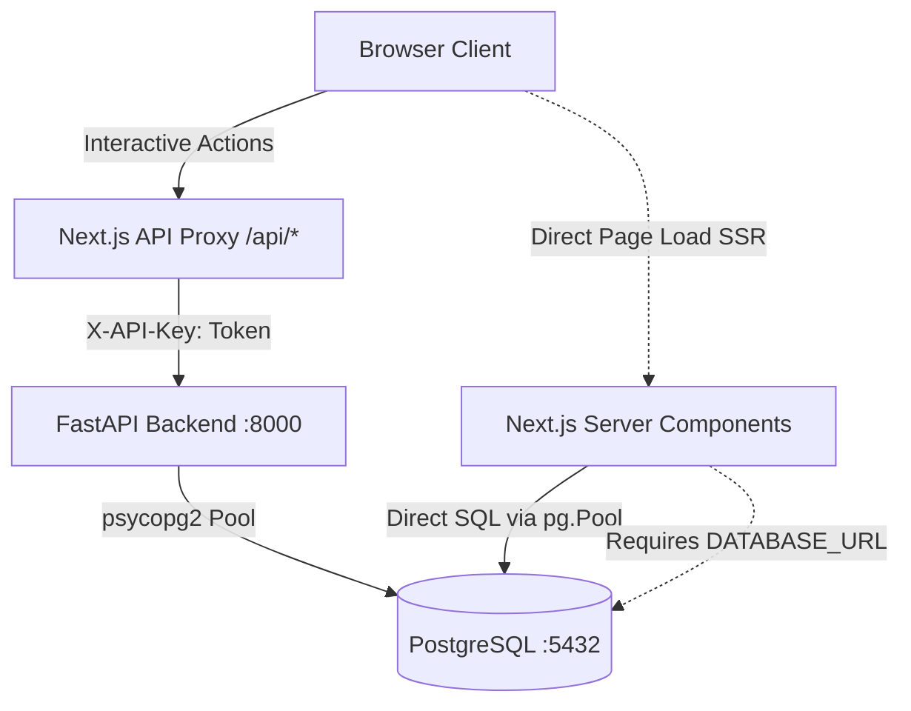

# Phase 6J.2: Frontend Server-Side Data Access Migration to FastAPI

## 1. Executive Summary

Phase 6J.2 completes the decoupling of the Next.js frontend from direct PostgreSQL database access. All server-side data reads previously performed using Node.js `pg.Pool` (`dashboard/src/lib/db.ts`) have been replaced with direct server-to-server HTTP calls to the FastAPI backend service via a new dedicated `apiClient.ts` module.

The frontend's direct dependency on `pg` and `@types/pg` has been completely eliminated from `package.json` and `package-lock.json`. `dashboard/src/lib/db.ts` has been deleted, and `DATABASE_URL` has been removed from all frontend environment templates and container configurations.

---

## 2. Architecture: Before vs. After

### Before Migration (Phase 6I-B / 6J.1)

*Issue:* The frontend bypassed FastAPI for initial page loads (`/`, `/business/[id]`, `/runs`), duplicating SQL queries and models in TypeScript, requiring direct database credentials (`DATABASE_URL`), and creating split connection pools.

### After Migration (Phase 6J.2)
```mermaid
graph TD
    Browser[Browser Client] -->|Client Requests| NextApp[Next.js App Router]
    
    subgraph Frontend Container [:3000]
        NextApp -->|Interactive API calls| ProxyRoute[Proxy Route /api/[[...path]]]
        NextApp -->|Server Component SSR| APIClient[Server API Client apiClient.ts]
    end
    
    ProxyRoute -->|HTTP + X-API-Key| FastAPI[FastAPI Backend :8000]
    APIClient -->|HTTP + X-API-Key| FastAPI
    
    subgraph Backend Container [:8000]
        FastAPI -->|psycopg2 / SQLAlchemy| Postgres[(PostgreSQL :5432)]
    end
```
*Result:* Single unified data boundary. The frontend has zero database drivers, zero database queries, and zero direct knowledge of PostgreSQL.

---

## 3. Files Changed

| File | Status | Description |
| :--- | :--- | :--- |
| `dashboard/src/lib/apiClient.ts` | **Created** | Dedicated server-to-server API client with URL resolution, token injection, timeout handling, and typed resource fetching. |
| `dashboard/src/types/index.ts` | **Updated** | Added TypeScript interfaces for `ChangeEvent`, `OutreachDraft`, and `PipelineRun`. |
| `dashboard/src/app/page.tsx` | **Updated** | Added `export const dynamic = 'force-dynamic'` to prevent build-time mock data baking into production HTML. |
| `dashboard/src/lib/businesses.ts` | **Updated** | Replaced `pg.Pool` SQL queries with `fetchFromBackend("/api/businesses?sort_by=opportunity")`. |
| `dashboard/src/lib/businessDetail.ts` | **Updated** | Replaced SQL queries with `fetchFromBackend("/api/businesses/{id}")`, preserving `transformRow` report nesting. |
| `dashboard/src/app/business/[id]/page.tsx` | **Updated** | Replaced direct SQL queries for change events and outreach drafts with `getChangeEvents` and `getOutreachDrafts`. |
| `dashboard/src/app/runs/page.tsx` | **Updated** | Replaced inline `query(...)` with `getPipelineRuns()` from `@/lib/apiClient`, preserving `stage_failure_counts`. |
| `dashboard/src/lib/db.ts` | **Deleted** | Removed PostgreSQL connection pool manager after confirming zero remaining callers. |
| `dashboard/package.json` | **Updated** | Removed `"pg"` and `"@types/pg"` dependencies; updated `"test"` script to run `node --test tests/*.test.mjs`. |
| `dashboard/package-lock.json` | **Updated** | Regenerated lockfile without `pg` or `@types/pg`. |
| `dashboard/.env.example` | **Updated** | Removed `DATABASE_URL` references. |
| `dashboard/README.md` | **Updated** | Removed `DATABASE_URL` from the environment configuration table. |
| `deploy/docker-compose.yaml` | **Updated** | Removed `DATABASE_URL` and `postgres` dependency from `frontend` container service. |
| `dashboard/tests/apiClient.test.mjs` | **Created** | Comprehensive test suite (21 unit tests) covering authentication, failure states, response mappings, and architectural boundary checks. |

---

## 4. API Contracts Used

1. **Business List:**
   - `GET /api/businesses?sort_by=opportunity`
   - Returns businesses sorted by `opportunity_score DESC NULLS LAST, id DESC`.
   - Used by `dashboard/src/lib/businesses.ts` and `dashboard/src/app/page.tsx`.

2. **Business Detail:**
   - `GET /api/businesses/{business_id}`
   - Returns enriched single business record including health profiles and AI reports.
   - Preserved report nesting via `transformRow(data.business)`.
   - Returns HTTP 404 for missing IDs; frontend renders Next.js `notFound()` without fallback to mock data.

3. **Change Events:**
   - `GET /api/businesses/{business_id}/changes`
   - Returns chronological change events with parsed JSON payloads (`changes`).
   - Returns HTTP 404 / `[]` when no history exists.

4. **Outreach Drafts:**
   - `GET /api/businesses/{business_id}/outreach`
   - Returns generated email/WhatsApp drafts and positioning angles.
   - Returns HTTP 404 / `null` when no draft exists.

5. **Pipeline Runs:**
   - `GET /api/runs?limit=20`
   - Returns pipeline runs with `stage_failure_counts`, `notes`, `business_records`, and success rates.
   - Preserves operational metrics table in `/runs`.

---

## 5. Database Dependency Removal Evidence

### A. Static Codebase Audits
- **`pg` and `@types/pg` imports:**
  - Automated scanner in `dashboard/tests/apiClient.test.mjs` verifies `0` imports of `pg`, `@types/pg`, or `db.ts` across `dashboard/src`.
- **`DATABASE_URL` references:**
  - Verified `0` references to `DATABASE_URL` in `dashboard/src`.
  - Removed `DATABASE_URL` from `dashboard/.env.example` and `dashboard/README.md`.
- **Package Manifests:**
  - `pg` and `@types/pg` removed from `dashboard/package.json` and verified absent in `dashboard/package-lock.json`.

### B. Container & Compose Decoupling
- In `deploy/docker-compose.yaml`, `frontend` service environment:
  ```yaml
  frontend:
    environment:
      PORT: 3000
      HOSTNAME: 0.0.0.0
      API_INTERNAL_URL: http://backend:8000
      API_AUTH_TOKEN: ${API_AUTH_TOKEN:-dev-secret-token-change-in-prod}
    depends_on:
      backend:
        condition: service_healthy
  ```
  - `DATABASE_URL` was removed.
  - `postgres` was removed from `frontend.depends_on`.
  - Backend retains `DATABASE_URL` and `depends_on: postgres`.

---

## 6. Authentication and Error-Handling Decisions

1. **Credential Secrecy:**
   - `API_AUTH_TOKEN` is accessed strictly via `process.env.API_AUTH_TOKEN` inside server-side code (`apiClient.ts` and `apiProxy.ts`).
   - Never exposed to browser bundles (no `NEXT_PUBLIC_` variables).
   - Injected into backend requests via `X-API-Key` header.
2. **Strict 404 Behavior:**
   - If `/api/businesses/{id}` returns 404, `getBusinessDetail` returns `null`, causing `business/[id]/page.tsx` to render `notFound()`.
   - Silent production fallback to static dummy data (e.g., Apex Dental) has been eliminated.
3. **Graceful Network & Failure Handling:**
   - `fetchFromBackend` implements configurable timeouts (`AbortController`, default 10s).
   - Non-2xx responses throw sanitized errors including HTTP status without leaking internal host paths, tokens, or credentials.
4. **Dynamic SSR Rendering:**
   - `export const dynamic = 'force-dynamic'` added to `dashboard/src/app/page.tsx` and `dashboard/src/app/runs/page.tsx`, ensuring live data is fetched on demand and build-time static mock data cannot be baked into production HTML.

---

## 7. Test Commands and Actual Results

| Test Category | Command | Result |
| :--- | :--- | :--- |
| **Frontend Unit & Proxy Tests** | `docker run --rm -v "$(pwd)/dashboard":/app -w /app node:20 npm test` | **44 passed, 0 failed, 1 skipped** (152ms) |
| **Frontend Production Build** | `docker run --rm -v "$(pwd)/dashboard":/app -w /app node:20 npm run build` | **Passed (Exit code 0)**; standalone bundle generated |
| **Frontend Container Smoke** | `/tmp/phase6-env/bin/pytest tests/test_frontend_container_smoke.py -v` | **4 passed in 1.69s** |
| **Python Offline Suite** | `/tmp/phase6-env/bin/pytest -m "not postgres_integration and not docker" -q` | **442 passed, 14 deselected in 8.21s** |
| **Kubernetes Manifest Tests** | `/tmp/phase6-env/bin/pytest tests/test_kubernetes_manifests.py -q` | **12 passed in 0.09s** |
| **Docker Compose Integration** | `docker compose -f deploy/docker-compose.yaml up --build -d` | **All 3 containers healthy** (`bi-frontend`, `bi-backend`, `bi-postgres`) |
| **Compose Live SSR Verification** | `curl -s http://127.0.0.1:3000/` & `/runs` & `/business/1001` | **Verified**: real data rendered, stage failures rendered, 404 handled cleanly |

---

## 8. Remaining Limitations & Deferred Work

1. **Kubernetes Frontend Manifests:**
   - Kubernetes manifests (`deploy/kubernetes/`) currently define backend services. Frontend deployment manifests are deferred to the designated platform phase.
2. **Client-side Mock Mode:**
   - Client-side mock fixtures in `dashboard/src/data/mockBusinesses.ts` remain for offline client component storybooks and unit testing, but are no longer active in production SSR paths.
